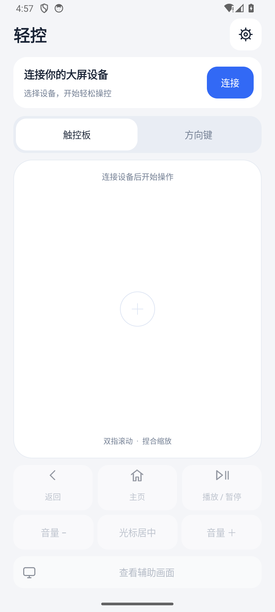
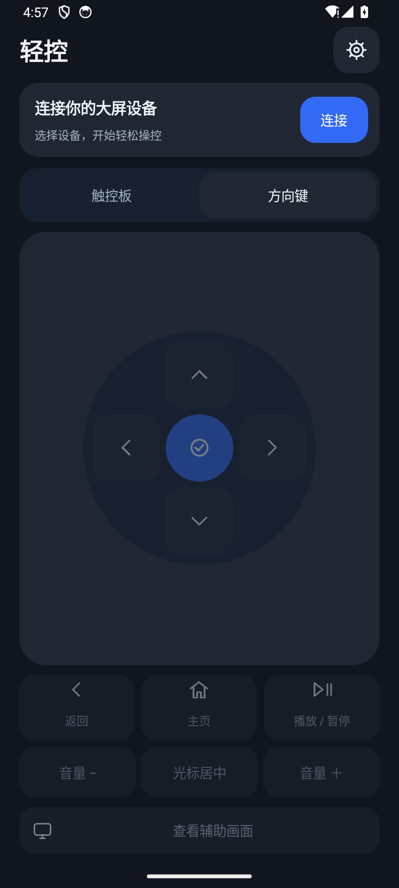

# Vela Remote · 轻控

用安卓手机控制电视盒子和大屏设备。手机上是一块触控板，下面放返回、主页、播放和音量键，布局参考 Apple TV A1513 遥控器。

支持局域网连接，也可以把手机当作蓝牙鼠标使用。当前版本 **0.3.0**，还在开发中。

<p align="center">
  
  
</p>

*截图为 0.2.0，新版增加了鼠标／触摸模式切换，调整了按键居中。*

## 能做什么

- 移动光标、点击、双击、长按和拖动；双指滚动，触摸模式下支持捏合缩放。
- 切换方向键，使用返回、主页、播放／暂停和音量键。
- 保存多台设备，在设备列表中切换；同时连接一台。
- 按需打开大屏画面预览。默认关闭，手机切到后台时也会关闭。
- 浅色／深色主题，可调整光标速度、滚动方向和振动反馈。

目前没有文字输入、语音、互联网远程或声音传输。

## 安装与连接

手机需要 **Android 12 或更新版本**。局域网受控端按 **Android 7.0～8.1** 开发，两端需要连到同一网络。

目前需要[从源码构建](#从源码构建)，将主控 APK 安装到手机，受控 APK 安装到大屏。默认构建使用调试签名；已有安装建议两端一起更新。

### 局域网

手机安装主控，大屏安装受控端。

**大屏有 Root：**启动遥控服务，在 Root 管理器中允许授权。优先使用 UHID 系统鼠标；旧内核会再尝试 uinput 兼容后端。两者都不可用时会显示原因，改用触摸兼容模式。兼容模式需要额外允许悬浮窗权限。主控端会禁用不可用的鼠标模式，避免点击后又跳回触摸。

**大屏没有 Root：**打开“无 Root：使用无障碍兼容模式”，按提示开启无障碍服务、授权兼容光标，再启动遥控服务。

然后在手机点“连接”，选中大屏，输入受控端显示的**六位配对码**，也可以扫码。找不到设备就选“输入设备地址”，填写大屏的 `IP:27183`。配对后会保存设备，下次从“我的设备”连接或切换。

受控端首次初始化成功后默认开机待命，可在设置中关闭。

如果自动发现和扫码都失败，先检查受控端是否显示“服务正常，等待连接”。部分设备虽有 Root，但内核不支持当前 UHID 接口（可能提示 `ENOTSUP`）；会先尝试 uinput 兼容后端。两个系统鼠标后端都失败时，需要先点击“授权兼容光标”允许悬浮窗，再启动遥控服务。仅开启 ADB 或授予 Root 不会自动获得这项权限。服务未就绪或已停止时不显示配对二维码。

### 蓝牙

目标设备需要支持蓝牙鼠标，手机固件需要支持 HID Device。

先在系统蓝牙设置中配对，再到主控的“连接／设备”→“蓝牙鼠标连接”选择目标。也可以选“让电视搜索此手机”，由电视发起配对。

蓝牙方式不需要在大屏安装受控端，也不需要 Root。它提供键鼠操作，没有画面预览和真实双指缩放；使用时保持主控在前台。

## 怎么操作

| 触控板手势 | 操作 |
|---|---|
| 单指滑动 | 移动光标，抬手后可以重新落指继续移动 |
| 轻点／连续轻点两次 | 点击／双击 |
| 轻点后再次按住移动 | 拖动，抬手结束 |
| 长按后移动 | 长按拖动 |
| 双指上下滑动 | 鼠标模式发送滚轮；触摸模式模拟手指滚动 |
| 双指捏合／张开 | 触摸模式下缩放，目标应用需要支持 |

日常点击用“鼠标”模式。需要上滑打开应用列表、拖动触摸界面或缩放时，切到“触摸”。两种模式的光标位置独立，切换后需要重新定位；“光标居中”只在触摸模式可用。

触控板按手机的逻辑像素计算位移，默认关闭光标加速度；可在设置里调整速度和加速度。开启加速度时按实际滑动速度计算，避免不同触摸上报频率改变灵敏度。局域网连续移动按约 60 次／秒合并发送，保留累计位移，按键和手势结束会按顺序立即发送，避免高频采样在受控端积压。

比如桌面上滑：切到触摸模式，把光标移到桌面下方空白处，轻点后再次按住向上滑。直接单指上滑只会移动光标，能否打开应用列表取决于启动器。

无障碍模式下，Android 8 可以接续手势；Android 7 要等抬手后才提交整段手势，拖动不会实时跟手。方向键能否工作也取决于目标应用的无障碍支持。

触摸模式的软件光标在无操作 30 秒后自动隐藏，下次移动、点击、滚动或按键时重新显示；后台心跳和状态更新不会延长显示时间。系统鼠标的隐藏行为由设备固件决定。

## 关于画面预览

预览用于辅助查看，操作仍在触控板上完成。默认最高 15fps，低负载档 10fps，流畅度受编码器和网络影响。受保护的视频内容可能黑屏。

无 Root 时，需先在受控端点击“备用画面采集授权”，确认系统录屏提示，再从手机打开预览。

## 目前测到哪了

双端构建通过，34 项单元测试通过，lint 无错误。已在 SM-F9660（Android 16）主控与 G1109（Android 8.0／Linux 3.10）受控端上验证局域网自动发现、二维码图像解码与实际配对、uinput 系统鼠标、鼠标／触摸模式切换，以及触摸光标闲置 30 秒隐藏和操作唤醒。

在上述设备与当前 Wi-Fi 网络的高频连续移动测试中，积压收尾时间由约 685ms 降至约 32ms，累计位移保持完整；这是该测试环境的测量结果。自动发现与直接连接验证未使用 ADB 端口转发。

此前还用 Android 14 主控和 Android 8.0 Root 模拟器测过旧版触摸、滚动、缩放、方向键和预览。摄像头实际扫码、无障碍和蓝牙功能，以及其他设备、路由器／热点和视频编码性能仍需进一步测试，不能保证所有盒子都能正常工作。

遇到问题可以附上双端版本、设备型号、Android 版本、连接方式和复现步骤；画面卡顿时也请注明编码器名称。不要贴配对凭据。

## 从源码构建

准备 JDK 17、Android SDK 36、NDK 28.2.13676358 和 CMake 4.1.2（uinput 兼容后端需要编译本地库），用 Android Studio 打开项目，或在 `local.properties` 中填写 `sdk.dir` 后运行：

```powershell
.\gradlew.bat :controller:assembleDebug :receiver:assembleDebug
```

APK 在各模块的 `build/outputs/apk/debug/`。macOS／Linux 将命令开头换成 `sh ./gradlew`。

检查与单元测试：

```powershell
.\gradlew.bat :shared:testDebugUnitTest :controller:lintDebug :receiver:lintDebug
```

代码分为 `controller`（主控）、`receiver`（受控）、`root-worker`（Root 输入与采集）和 `shared`（协议与手势）。局域网控制使用 TLS，视频单独传输；Root 输入通过常驻进程处理。
